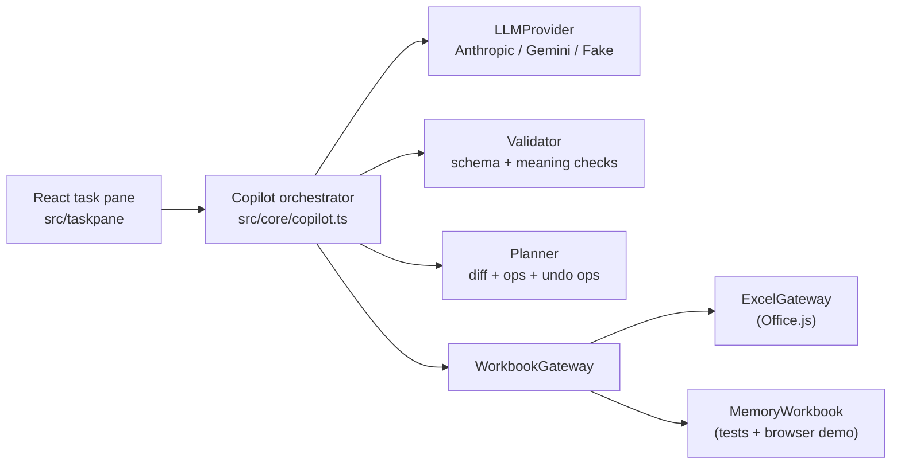

# Excel Copilot

An Excel task-pane add-in that turns natural-language requests into validated, previewable, and reversible spreadsheet edits. Requests such as *"add a Revenue column = Units × Price and bold the header"* are sent to Claude or Gemini, which return structured JSON actions; the add-in validates them, shows a cell-level diff, applies them only on confirmation, and supports one-click undo. It can also explain the formula in the selected cell.

The core logic (schema, validator, planner, undo) is plain TypeScript with no Excel dependency, so it is fully unit-tested and the whole UI also runs in a browser against an in-memory workbook.

## Features

- **Structured actions**: `write_formula`, `fill_range` (values or a per-row formula template), `format`, and `explain`, defined by a Zod schema that also generates the JSON Schema sent to the model.
- **Two-layer validation**: shape (types, required and extra keys) and meaning (sheets and addresses exist, array dimensions match the range, formulas are balanced, size limits, no `WEBSERVICE`, DDE, or external links).
- **Repair loop**: on validation failure, the model receives its reply and the list of issues for one retry; if that also fails, nothing is applied.
- **Preview diff**: before/after values for every cell that will change.
- **Undo with safety checks**: refuses to apply a stale preview, and warns before undo would overwrite cells edited after applying.
- **Formula explanation** for the selected cell.
- **Browser demo mode** with a sample workbook and a keyword-based demo provider that needs no API key.
- **Providers**: Google Gemini (default, `gemini-3.8-flash`) and Anthropic Claude (`claude-opus-5-5`), both using structured-output mode.

## Architecture



Request flow:

1. **Context.** The gateway reads sheet names, the selection, and the top of the used range. `prompt.ts` renders it inside `<workbook>` tags, marked as data rather than instructions.
2. **LLM.** The provider sends the system prompt, the user message, and the generated JSON Schema.
3. **Validate.** `validator.ts` returns a list of issues instead of throwing. Any error triggers the single repair attempt; application is all-or-nothing.
4. **Plan and preview.** The gateway reads the target cells (the snapshot). `planner.ts` simulates the actions on a copy and produces the diff and low-level write operations (`setContents`, `setStyle`).
5. **Apply and undo.** On Apply, the target cells are re-read; if they changed since the preview, the apply is refused. Otherwise that read becomes the undo snapshot and all operations are written in one batch. The cells are read again after writing, and undo compares against that read to detect later edits (drift) before restoring.

Structure:

- **Ports and adapters.** The core depends only on the `WorkbookGateway` interface. `ExcelGateway` implements it with Office.js; `MemoryWorkbook` implements it with a plain object. `architecture.test.ts` fails if `src/core` imports Excel, React, or the DOM.
- **Interchangeable providers.** `LLMProvider` has one method, `complete()`; Claude, Gemini, and a scripted fake share it.
- **Pure planner.** `buildPlan(actions, snapshot)` has no side effects, so preview and undo are deterministic and directly testable.

### Action schema

```jsonc
{
  "summary": "Adds a Revenue column",
  "actions": [
    { "type": "write_formula", "cell": "D1", "formula": "=\"Revenue\"" },
    { "type": "fill_range", "range": "D2:D5", "formulaTemplate": "=B{row}*C{row}" },
    { "type": "fill_range", "range": "A6:B6", "values": [["Total", "=SUM(B2:B5)"]] },
    { "type": "format", "range": "A1:D1", "style": { "bold": true, "fillColor": "#FFF2CC" } },
    { "type": "explain", "target": "D2", "text": "Units times price." }
  ]
}
```

### Tech stack

| Component | Role |
|---|---|
| TypeScript (strict) | Compile-time checking of cell, action, and plan shapes |
| Office.js | Excel read/write API, loaded from Microsoft's CDN |
| React 19 | Task-pane UI |
| Zod | Single source for runtime validation, TypeScript types, and the LLM JSON Schema |
| `@anthropic-ai/sdk` | Claude requests, typed errors, retries, structured output |
| `fetch` | Gemini `generateContent` REST calls |
| Vite | Dev server (HTTPS on port 3000) and bundler |
| Vitest, Testing Library, jsdom | Unit and UI tests |
| office-addin-dev-certs, -debugging, -manifest | Localhost HTTPS certificate, sideloading, manifest validation |

## Quickstart

Requires Node.js 20+ (22 recommended). Excel integration requires Excel for Mac (Microsoft 365, 16.x).

```bash
conda create -n excel-copilot -c conda-forge nodejs=22 -y   # optional: Node in a conda env
conda activate excel-copilot
npm install
```

API keys are not stored in any file. They are entered in the add-in's **Settings** panel and kept in that browser's localStorage. Keys are available from <https://aistudio.google.com/apikey> and <https://console.anthropic.com>.

### Browser demo (no Excel, no key)

```bash
npm run dev
```

Open <http://localhost:3000>. In **Settings**, either add a Gemini key or select **Demo (no key, canned answers)**. Click a suggestion (e.g. "Fill in the Revenue column"), then **Preview changes → Apply → Undo**. Select a formula cell and click **Explain selected formula**.

### Sideload into Excel for Mac

Office loads add-ins only over HTTPS. Install a trusted localhost certificate once (prompts for the macOS password to add a development root certificate):

```bash
npm run certs
```

Start the dev server, copy the manifest into Excel's sideload folder, and open Excel:

```bash
npm run sideload
```

Alternatively, run `npm run dev` and copy the manifest manually:

```bash
mkdir -p ~/Library/Containers/com.microsoft.Excel/Data/Documents/wef && cp manifest.xml ~/Library/Containers/com.microsoft.Excel/Data/Documents/wef/
```

Restart Excel, open a workbook, and choose **Home → Add-ins** (or **Insert → Add-ins → My Add-ins**) → **Developer Add-ins** → **Excel Copilot**. A **Copilot** button is also added to the Home tab. In the pane, open **Settings**, choose a provider, paste a key, and click **Save**.

Remove the add-in:

```bash
npm run unsideload
```

Troubleshooting:

- Right-click in the task pane → **Inspect Element** opens Safari Web Inspector. If the option is missing, run `defaults write com.microsoft.Excel OfficeWebAddinDeveloperExtras -bool true` and restart Excel.
- A blank pane usually means <https://localhost:3000> does not load in Safari without a certificate warning.

Validate the manifest (sends it to Microsoft's validation service):

```bash
npm run validate-manifest
```

## Running tests

```bash
npm test            # 120 tests across 11 files
npm run check       # typecheck + tests
```

| File | Coverage |
|---|---|
| `a1.test.ts` | A1 address parsing edge cases |
| `formula.test.ts` | Blocked functions, strings, DDE, external links |
| `schema.test.ts` | Schema acceptance/rejection; provider-compatible JSON Schema |
| `validator.test.ts` | Every validation rule |
| `planner.test.ts` | Diffs, templates, apply → undo round trip |
| `prompt.test.ts` | Exact text sent to the LLM |
| `copilot.test.ts` | End-to-end flow with the fake provider and in-memory workbook: repair, stale preview, drift |
| `providers.test.ts` | Anthropic and Gemini request, response, and error mapping with stubbed `fetch` |
| `settings.test.ts` | Settings persistence and missing-key messages |
| `architecture.test.ts` | `src/core` has no Excel, React, or DOM imports |
| `app.test.tsx` | React UI in jsdom: preview, apply, undo, explain |

## Project structure

```
excel-copilot/
├── manifest.xml               Add-in manifest: icons, task-pane URL, ribbon button, ExcelApi 1.9 requirement
├── package.json               Dependencies and npm scripts
├── tsconfig.json              Strict TypeScript settings
├── vite.config.ts             Dev server (HTTPS when certs exist), build, Vitest config
├── DECISIONS.md               Design decision log
├── assets/icon-*.png          Add-in icons (16–128 px)
├── scripts/make-icons.mjs     Generates the PNG icons with plain Node
├── src/
│   ├── core/                  Pure TypeScript: no Excel, React, or network
│   │   ├── a1.ts              A1 address parsing/formatting and range helpers
│   │   ├── schema.ts          Zod action schema and generated JSON Schema
│   │   ├── formula.ts         Formula scanner: brackets, blocked functions, references
│   │   ├── validator.ts       Shape and meaning validation
│   │   ├── types.ts           CellState, Snapshot, WorkbookContext, WriteOp
│   │   ├── cells.ts           Cell content and format comparison/display
│   │   ├── planner.ts         Actions → diff, write ops, undo ops; snapshot comparison
│   │   ├── prompt.ts          System prompt and workbook context rendering
│   │   ├── gateway.ts         WorkbookGateway interface
│   │   ├── memoryWorkbook.ts  In-memory gateway implementation
│   │   └── copilot.ts         Orchestrator: propose (with repair), apply, undo, explain
│   ├── providers/
│   │   ├── types.ts           LLMProvider interface and ProviderError
│   │   ├── anthropic.ts       Claude via the SDK; structured output with refusal fallback
│   │   ├── gemini.ts          Gemini via REST with responseJsonSchema
│   │   └── fake.ts            Scripted provider for tests
│   ├── excel/excelGateway.ts  Office.js adapter
│   ├── demo/
│   │   ├── demoData.ts        Sample sales workbook
│   │   └── demoProvider.ts    Keyword-based demo provider
│   └── taskpane/
│       ├── index.html         Task-pane page; loads office.js from Microsoft's CDN
│       ├── main.tsx           Entry point: Excel or demo mode
│       ├── App.tsx            Propose → preview → apply → undo UI
│       ├── settings.ts        Provider, model, and key settings (localStorage)
│       ├── providerFactory.ts Builds the configured LLMProvider
│       ├── styles.css         Light and dark styles
│       └── components/        PreviewTable, IssueList, SettingsPanel, DemoGrid
└── tests/                     Vitest suite (see Running tests)
```

## Design decisions

See [DECISIONS.md](DECISIONS.md) for the full log. Highlights:

- **Validate even with structured output.** A JSON Schema cannot express constraints such as "a 2×3 range needs a 2×3 array", so semantic validation runs on every reply.
- **Bounded repair.** One retry with the validation errors fixes most mistakes without risking a loop.
- **Cell contents are untrusted.** Workbook data is delimited as data in the prompt, and functions that can send data to a URL (`WEBSERVICE`), DDE, and external links are blocked.
- **Optimistic concurrency.** Snapshot before writing (undo), re-read before applying (stale preview), and compare before undoing (drift).
- **Batched Office.js access.** Reads use `getCellProperties` and writes are queued and sent with a single `context.sync()`; formats are restored with `setCellProperties`.
- **Discriminated union for actions**, so TypeScript narrows each action type and flags unhandled cases.
- **No SDK for Gemini.** `generateContent` is a single REST call, which is simple to stub in tests.

## Limitations and future work

- Formulas are not evaluated in the preview; Excel calculates them after Apply.
- The formula scanner is a best-effort lexer, not a full Excel parser.
- Undo history is in memory and covers only changes made through the add-in in the current session.
- Provider integrations are tested with stubbed responses; live API calls are not part of the test suite.
- API keys are stored in the browser. A shared deployment should route LLM calls through a backend.
