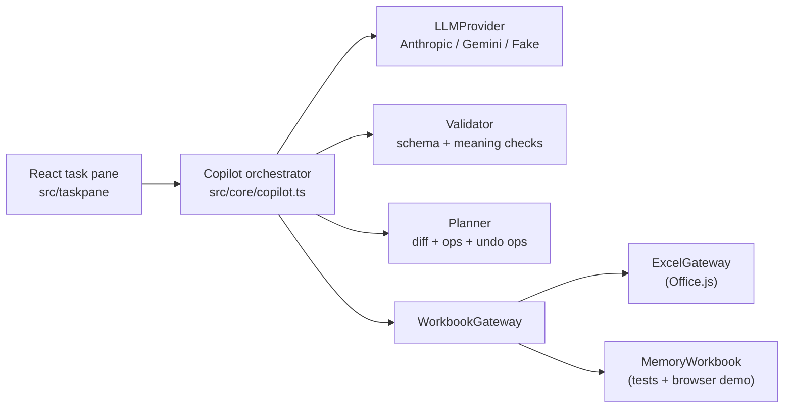

# Excel Copilot

An Excel add-in that lives in a side panel (a "task pane"). You type a request
like *"add a Revenue column = Units × Price and bold the header"*. An LLM (Claude
or Gemini) replies with **structured JSON actions**. The add-in **validates** every
action, shows a **preview diff** of the cells that will change, applies them only
when you click **Apply**, and keeps a **snapshot** so you can **undo** in one click.
It can also **explain the formula** in the selected cell in plain English.

The core logic (schema, validator, planner, undo) is plain TypeScript with no
Excel dependency, so all of it is unit-tested with Vitest, and the whole UI also
runs in an ordinary browser tab against a fake in-memory workbook.

---

## Tools and libraries (and why)

| Tool | Why |
|---|---|
| **TypeScript** | Types catch mistakes in data shapes (cells, actions, plans) at compile time. |
| **Office.js** (`@types/office-js`) | Microsoft's JavaScript API for reading and writing Excel from an add-in. Loaded from Microsoft's CDN, as required. |
| **React 19** | Builds the task-pane UI out of small components with simple state. |
| **Zod** | Defines the action schema once and gives us *both* runtime validation and TypeScript types, plus a generated JSON Schema for the LLM. |
| **@anthropic-ai/sdk** | Official Claude SDK: typed requests, typed errors, retries, structured output. |
| **fetch** (for Gemini) | Gemini's `generateContent` is a single REST call; no SDK needed and easy to stub in tests. |
| **Vite** | Dev server + bundler with almost no config; serves the task pane over HTTPS on port 3000. |
| **Vitest** + **Testing Library** + **jsdom** | Fast tests that share Vite's config; Testing Library drives the React UI like a user would. |
| **office-addin-dev-certs / -debugging / -manifest** | Microsoft's CLI helpers: trusted localhost HTTPS cert, sideloading into Excel, manifest validation. |

---

## Architecture (read this first)



A request flows through five steps:

1. **Context.** The gateway reads sheet names, the selection and the top of the
   used range. `prompt.ts` turns that into text, wrapped in `<workbook>` tags
   and marked as *data, not instructions*.
2. **LLM.** The provider sends the system prompt, the message and the JSON Schema
   (generated from Zod). Both providers use their "structured output" mode.
3. **Validate.** `validator.ts` checks the reply in two layers:
   *shape* (Zod: right keys and types, no extra keys) and *meaning* (addresses
   exist, sheet exists, a 2×3 range gets a 2×3 array, formulas balance, no
   `WEBSERVICE`/DDE/external links, size limits). If anything fails, the model
   sees its reply plus the problem list and gets **one repair attempt**. If that
   fails too, nothing is applied. It's all-or-nothing.
4. **Plan + preview.** The gateway reads the target cells (the *snapshot*).
   `planner.ts` simulates the actions on a copy and produces the **diff** (which
   cells change, before → after) and the low-level **ops** (`setContents`,
   `setStyle`). The UI shows the diff.
5. **Apply / undo.** On Apply, the cells are read *again*: if they changed since
   the preview, the add-in refuses ("stale preview"). Otherwise that fresh read
   becomes the **undo snapshot**, and the ops are written in one batch. Undo first
   checks for **drift** (cells you edited after applying) and warns before
   overwriting them.

Three design ideas hold this together:

- **Ports and adapters.** The core only knows the `WorkbookGateway` interface.
  `ExcelGateway` adapts it to Office.js; `MemoryWorkbook` adapts it to a JS object.
  So the core runs in tests and in a browser without Excel.
- **Strategy pattern for LLMs.** `LLMProvider` has one method, `complete()`. Claude,
  Gemini and the fake are interchangeable.
- **Pure planner.** `buildPlan(actions, snapshot)` is a pure function: same input,
  same output, no side effects. That's why preview and undo are easy to test.

### The action schema

```jsonc
{
  "summary": "Adds a Revenue column",
  "actions": [
    { "type": "write_formula", "cell": "D1", "formula": "=\"Revenue\"" },
    { "type": "fill_range", "range": "D2:D5", "formulaTemplate": "=B{row}*C{row}" },
    { "type": "fill_range", "range": "A6:B6", "values": [["Total", "=SUM(B2:B5)"]] },
    { "type": "format", "range": "A1:D1", "style": { "bold": true, "fillColor": "#FFF2CC" } },
    { "type": "explain", "target": "D2", "text": "Units times price." }
  ]
}
```

---

## File structure

```
excel-copilot/
├── manifest.xml               Add-in manifest: name, icons, task-pane URL, ribbon button, ExcelApi 1.9 requirement
├── package.json               Dependencies and npm scripts (dev, build, test, check, sideload…)
├── package-lock.json          Exact dependency versions
├── tsconfig.json              TypeScript compiler settings (strict mode)
├── vite.config.ts             Dev server (HTTPS on :3000 when certs exist), build output, Vitest config
├── DECISIONS.md               Log of design choices and why they were made
├── README.md                  This file
├── .gitignore                 Keeps node_modules, dist, .env, .DS_Store etc. out of git
├── .claude/launch.json        Dev-server config for Claude Code's preview browser
├── assets/icon-*.png          Add-in icons (16–128 px), generated by scripts/make-icons.mjs
├── scripts/
│   └── make-icons.mjs         Draws the PNG icons with plain Node (no image libraries)
├── src/
│   ├── core/                  Pure TypeScript: no Excel, no React, no network
│   │   ├── a1.ts              Parse/format A1 addresses ("Sheet1!B2:C5"), range helpers
│   │   ├── schema.ts          Zod schema for LLM actions + generated JSON Schema
│   │   ├── formula.ts         Lightweight formula scanner: brackets, blocked functions, references
│   │   ├── validator.ts       Two-layer validation (shape + meaning) returning a list of issues
│   │   ├── types.ts           Shared data types: CellState, Snapshot, WorkbookContext, WriteOp
│   │   ├── cells.ts           Compare/display cell content and formats
│   │   ├── planner.ts         Simulate actions -> diff, write ops, undo ops, drift detection
│   │   ├── prompt.ts          System prompt and rendering the workbook context as text
│   │   ├── gateway.ts         The WorkbookGateway interface (the "port")
│   │   ├── memoryWorkbook.ts  In-memory workbook implementing the gateway (tests + demo)
│   │   └── copilot.ts         Orchestrator: propose (with repair), apply, undo, explain
│   ├── providers/
│   │   ├── types.ts           LLMProvider interface and ProviderError
│   │   ├── anthropic.ts       Claude via the official SDK, structured output + refusal fallback
│   │   ├── gemini.ts          Gemini via REST generateContent with responseJsonSchema
│   │   └── fake.ts            Scripted provider for tests
│   ├── excel/
│   │   └── excelGateway.ts    The Office.js adapter: reads/writes real Excel cells and formats
│   ├── demo/
│   │   ├── demoData.ts        Sample sales workbook for browser demo mode
│   │   └── demoProvider.ts    Keyword-based fake "LLM" so the demo works with no API key
│   └── taskpane/
│       ├── index.html         Task-pane page; loads office.js from Microsoft's CDN
│       ├── main.tsx           Entry point: picks Excel or demo mode
│       ├── App.tsx            Main UI and the propose -> preview -> apply -> undo flow
│       ├── settings.ts        Provider/model/API-key settings saved in localStorage
│       ├── providerFactory.ts Builds the right LLMProvider from settings
│       ├── styles.css         Task-pane styles (light + dark)
│       └── components/
│           ├── PreviewTable.tsx  The diff table (cell, before, after)
│           ├── IssueList.tsx     Validation errors and warnings
│           ├── SettingsPanel.tsx Provider picker and API-key inputs
│           └── DemoGrid.tsx      Mini spreadsheet shown only in browser demo mode
└── tests/
    ├── a1.test.ts             Address parsing edge cases
    ├── formula.test.ts        Formula scanner: blocked functions, strings, DDE, external links
    ├── schema.test.ts         Schema accepts/rejects; JSON Schema is provider-friendly
    ├── validator.test.ts      Every validation rule
    ├── planner.test.ts        Diffs, templates, apply -> undo round trip, drift
    ├── prompt.test.ts         Exactly what text the LLM sees
    ├── copilot.test.ts        End-to-end flow with FakeProvider + MemoryWorkbook (repair, stale, drift)
    ├── providers.test.ts      Anthropic + Gemini request/response/error mapping with stubbed fetch
    ├── settings.test.ts       Settings load/save and missing-key messages
    ├── architecture.test.ts   Fails if src/core ever imports Excel, React or the DOM
    └── app.test.tsx           Drives the React UI in jsdom: preview, apply, undo, explain
```

---

## Setup

You need **Node.js 20+** (22 recommended) and, for the Excel part, **Excel for Mac**
(Microsoft 365, version 16.x).

This is a JavaScript project, so dependencies live in `node_modules/` inside the
folder (already isolated per project). If you want Node itself in a conda
environment instead of a system install:

```bash
conda create -n excel-copilot -c conda-forge nodejs=22 -y
```

```bash
conda activate excel-copilot
```

Then, from the project folder:

```bash
cd ~/projects/excel-copilot
```

```bash
npm install
```

API keys are **not** put in any file. You paste them into the add-in's
**Settings** panel; they are stored in that browser's localStorage only. Get
them from <https://console.anthropic.com> or <https://aistudio.google.com/apikey>.

---

## How to run

### 1. Try it in a browser (no Excel, no key)

```bash
npm run dev
```

Open <http://localhost:3000>. You'll see a demo sales sheet. Click a suggestion
chip (e.g. "Fill in the Revenue column"), then **Preview changes → Apply → Undo**.
Click a formula cell and press **Explain selected formula**.

### 2. Run the tests

```bash
npm test
```

Typecheck and tests together:

```bash
npm run check
```

### 3. Sideload into Excel for Mac

Office only loads add-ins over HTTPS, so first install a trusted localhost
certificate (one-time; it asks for your Mac password because it adds a
development root certificate to your keychain):

```bash
npm run certs
```

**Option A, automatic.** This starts the dev server, copies the manifest into
Excel's sideload folder and opens Excel:

```bash
npm run sideload
```

**Option B, manual.** Start the dev server:

```bash
npm run dev
```

In a second terminal, copy the manifest into Excel's developer add-in folder:

```bash
mkdir -p ~/Library/Containers/com.microsoft.Excel/Data/Documents/wef && cp manifest.xml ~/Library/Containers/com.microsoft.Excel/Data/Documents/wef/
```

Then quit and reopen Excel, open any workbook, and go to **Home → Add-ins**
(or **Insert → Add-ins → My Add-ins**). Look under **Developer Add-ins** and pick
**Excel Copilot**. A **Copilot** button also appears on the Home tab.

In the pane: **Settings** → choose *Anthropic Claude* or *Google Gemini* → paste
your key → **Save**.

To remove it again:

```bash
npm run unsideload
```

(or delete `manifest.xml` from the `wef` folder above).

**Debugging tips:** in the task pane, right-click → **Inspect Element** opens
Safari Web Inspector. If it isn't offered, run
`defaults write com.microsoft.Excel OfficeWebAddinDeveloperExtras -bool true`
in Terminal and restart Excel. If the pane is blank, check that
<https://localhost:3000> opens in Safari without a certificate warning.

Validate the manifest (this sends it to Microsoft's validation service):

```bash
npm run validate-manifest
```

---

## How it was built (in order)

1. **Scaffold**: git, `.gitignore`, `package.json`, strict `tsconfig`, Vite + Vitest config.
2. **A1 helpers** (`a1.ts`): turn `"Sheet1!B2:C5"` into numbers and back; tested first because everything depends on it.
3. **Schema** (`schema.ts`): Zod definitions for the four actions; JSON Schema generated from it.
4. **Formula scanner + validator**: shape checks via Zod, then meaning checks, returning issues instead of throwing.
5. **Planner + MemoryWorkbook**: simulate actions → diff → ops → undo ops; round-trip test proves undo restores the sheet exactly.
6. **Providers + prompt + orchestrator**: provider interface, Claude (SDK) and Gemini (REST) adapters tested with stubbed `fetch`; the `Copilot` class adds the repair loop, stale-preview refusal and drift check.
7. **Office.js adapter** (`excelGateway.ts`): reads values/formulas/formats with `getCellProperties`, writes in one batch, restores formats with `setCellProperties`.
8. **React task pane + demo mode**: preview table, apply/undo history, settings, explain; demo workbook and keyword provider so it runs in a browser.
9. **Manifest + icons**: validated with `office-addin-manifest`.
10. **Browser check + UI tests**: clicked through the demo flow (found and fixed unreadable text on filled cells in dark mode), added Testing Library tests and an architecture test.

Every step was a separate commit; see `git log` and `DECISIONS.md`.

---

## Key concepts (what to understand for an interview)

- **Structured output from LLMs.** Never trust free text. Ask for JSON matching a
  schema (the provider's structured-output mode), then **validate anyway**, because
  a schema can't express "a 2×3 range needs a 2×3 array".
- **Validate → preview → apply → undo.** LLM actions are *proposals*. A human sees a
  diff before anything changes, and every change is reversible. This is the core
  safety pattern for AI agents that act on real data.
- **Repair loop.** Feeding validation errors back to the model ("here's what was
  wrong, try again") fixes most mistakes for the cost of one extra call. Bound it
  (here: 1 retry) so it can't loop forever.
- **Prompt injection via data.** Cell contents are untrusted input. We mark them as
  data in the prompt *and* block dangerous functions (`WEBSERVICE` could send your
  data to a URL), so a malicious cell can't make the model exfiltrate data.
- **Ports and adapters / dependency inversion.** The core depends on an interface
  (`WorkbookGateway`), not on Excel. That's what makes it testable and lets the
  same UI run in a browser demo.
- **Strategy pattern.** `LLMProvider` lets Claude, Gemini and a fake be swapped
  without touching the rest of the code; the fake makes tests fast, free and
  deterministic.
- **Pure functions.** `buildPlan(actions, snapshot)` has no side effects, so it's
  trivially testable. Side effects live at the edges (gateway, provider).
- **Snapshots and optimistic concurrency.** We snapshot before writing (undo), re-read
  before applying (stale-preview check) and compare before undoing (drift). The same
  idea as version checks in databases.
- **Office.js batching.** `load()` and property writes are *queued* on proxy objects;
  `context.sync()` sends the batch. Fewer syncs mean a faster add-in.
- **Discriminated unions.** `type: "write_formula" | "fill_range" | …` lets
  TypeScript narrow each action in a `switch` and catch missing cases.

---

## Limitations

- Formulas aren't evaluated in the preview; you see the formula text, and Excel
  calculates after Apply.
- The formula scanner is a best-effort lexer, not a full Excel parser.
- Undo covers changes made through this add-in during the current session (history
  lives in memory; closing the pane clears it).
- The real Claude and Gemini calls were written against the documented APIs and
  tested with stubbed responses; run one real request after adding your key.
- API keys live in the browser. Fine for personal use; a shared deployment should
  call the LLM through a small backend instead.
